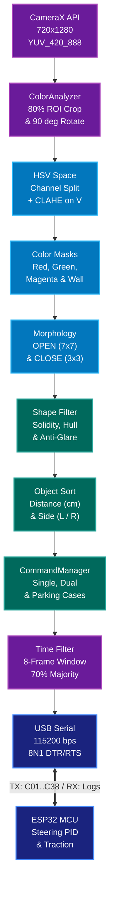
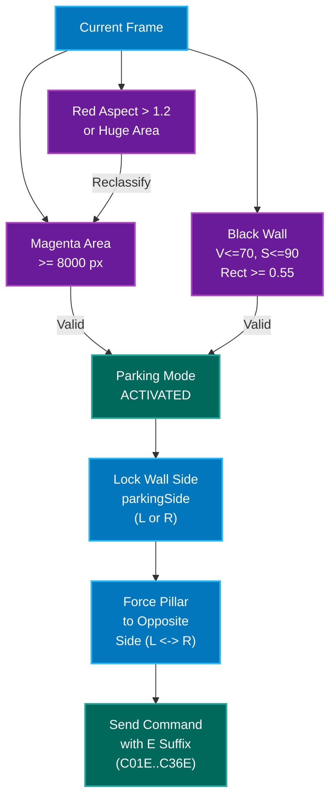

# 🤖 WRO Prometheus App — Computer Vision System (v5.0)

**WRO Prometheus App** is the high-performance computer vision processing unit developed by **PROMETHEUS TEAM** for the **World Robot Olympiad (WRO) 2026 - Future Engineers Category**.

This application turns an Android device into a smart vision coprocessor capable of detecting, classifying, and calculating the spatial position of track obstacles (red and green pillars) and parking zones (magenta boundary markers and black walls). It transmits stabilized decision commands in real time to a microcontroller (**ESP32 / Arduino**) via **USB Serial communication at 115200 bps**.

> 🌐 **For more complete information about the vehicle, mechanics, electronics, and overall strategy, visit our main repository:**
> [**Prometheus-Team-2026 (Main Repository)**](https://github.com/erchivox/Prometheus-Team-2026)

## 🌟 Main Features

1. **Simultaneous Dual Detection (`DualObjectDetection`):** Ability to track and evaluate up to two obstacles at the same time (Primary Object in the front zone and Secondary Object in the rear zone) to plot complex trajectories.

2. **Adaptive Lighting Normalization (CLAHE):** Contrast Limited Adaptive Histogram Equalization applied directly to the brightness channel ($V$) in the $HSV$ color space, ensuring immunity to shadows or sudden light changes on the track.

3. **Multi-layer Geometric Filtering:** Discards false positives (leaves, track reflections, external elements) through the analysis of solidity, convexity, convexity defects, rectangularity, perimeter-area ratio, and sharp peak detection ($< 45^\circ$).

4. **Internal Saturation Anti-Glare Filter:** Evaluates the average saturation inside the contour mask to distinguish between a real physical pillar and its reflection projected on the glossy track floor.

5. **Hybrid Parking Mode Detection:** Automatic activation of the parking protocol (`E Commands`) via **Magenta** marker detection, width/area reclassification, or **Black Wall** detection resting on the bottom edge of the ROI.

6. **Time-Based Sliding Window & Voting Filter:** Stabilization system that evaluates an 8-frame window requiring a $70\%$ majority and a time persistence before dispatching the USB command, eliminating flickering or decision noise.

7. **8-Sample On-Track Calibration:** Interactive camera overlay tool to sample the hue across the 8 track sections (4 clockwise and 4 counterclockwise) with automatic clipping of Red/Magenta overlaps.

## 🏗️ Overall System Architecture

The following diagram illustrates the complete data flow from optical capture in CameraX to physical actuation in the microcontroller:



## 👁️ Computer Vision Pipeline (`ColorAnalyzer.kt`)

Every frame delivered by `CameraX` goes through a strict 12-stage validation funnel before becoming a valid candidate:

```text
+-----------------------------------------------------------------------------------+
| 1. YUV_420_888 IMAGE  -->  NV21 to Bitmap Conversion  -->  ROI Crop (80%)         |
+-----------------------------------------------------------------------------------+
                                         |
                                         v
+-----------------------------------------------------------------------------------+
| 2. HSV SPACE + CLAHE                                                              |
|    RGB -> HSV | Split(H, S, V) -> CLAHE(Clip: 1.2, Grid: 8x8) on V -> Merge       |
+-----------------------------------------------------------------------------------+
                                         |
                                         v
+-----------------------------------------------------------------------------------+
| 3. SEGMENTATION & MORPHOLOGY                                                      |
|    inRange(Red1 + Red2, Green, Magenta, Wall) -> MORPH_OPEN(7x7) -> CLOSE(3x3)    |
+-----------------------------------------------------------------------------------+
                                         |
                                         v
+-----------------------------------------------------------------------------------+
| 4. TWO-PASS POLYGONAL SMOOTHING (approxPolyDP)                                    |
|    Pass 1: Epsilon = 0.008 * Perimeter  |  Pass 2: Epsilon = 0.004 * Perimeter    |
+-----------------------------------------------------------------------------------+
                                         |
                                         v
+-----------------------------------------------------------------------------------+
| 5. GEOMETRIC & PHYSICAL VALIDATION FUNNEL                                         |
|    ├── Area > 280 px? (Magenta > 840 px)                                          |
|    ├── Aspect Ratio > 1.2 in Red? ──(Yes)──> Reclassify to Parking                |
|    ├── Solidity (Area / Hull) >= 0.40?                                            |
|    ├── Convexity >= 0.85 & Defects <= 3?                                          |
|    ├── No triangular peaks (angles < 45°)?                                        |
|    ├── Vertices between 4 and 12?                                                 |
|    └── Average Internal Saturation >= Anti-Glare Threshold?                       |
+-----------------------------------------------------------------------------------+
                                         |
                                         v
+-----------------------------------------------------------------------------------+
| 6. SCORING & SELECTION (Sorting)                                                  |
|    Score = (0.6 * Solidity) + (0.4 * Norm_Saturation)                             |
|    Sort by Estimated Distance (Closest = Primary, 2nd = Secondary)                |
+-----------------------------------------------------------------------------------+
```

## 📐 Mathematical and Spatial Model

### 1. Area-Based Distance Calculation

The distance in centimeters from the camera to the obstacle is estimated using an inversely proportional relationship to the square root of the projected area in pixels, calibrated against an empirical reference constant:

$$
d_{\text{calc}} = \sqrt{\frac{A_{\text{ref}}}{A_{\text{current}}}} \times d_{\text{ref}}
$$

The obtained value is bounded within the system's operational limits ($10\text{ cm}$ to $200\text{ cm}$):

$$
d_{\text{final}} = \min\left(\max\left(d_{\text{calc}}, 10\right), 200\right)
$$

> **Note:** Any contour whose raw distance (`estimateRawDistance`) exceeds the maximum limit of the rear zone (`backDistanceMax`) is immediately discarded to prevent distant objects in another track section from polluting the current reading.

### 2. Spatial Frame Division (Orientation `L` / `R`)

Due to the $90^\circ$ rotation applied to the ROI to match the phone's physical mounting on the robot, the division between left (`L`) and right (`R`) is calculated using a normalized threshold of $60\%$ ($0.60$):

$$
X_{\text{norm}} = \frac{X_{\text{center}}}{W_{\text{ROI}}}
$$

* If $X_{\text{norm}} < 0.60 \implies$ **Left (`L`)**

* If $X_{\text{norm}} \ge 0.60 \implies$ **Right (`R`)**

```text
         Processed Camera Frame (Robot's View)
    0.00                        0.60                1.00
     +---------------------------+-------------------+
     |                           |                   |
     |           LEFT            |       RIGHT       |
     |           ZONE            |       ZONE        |
     |           (L)             |        (R)        |
     |                           |                   |
     |     [Primary Object]      |                   |
     |                           |    [Secondary]    |
     +---------------------------+-------------------+
                                 ^
                   Yellow Dividing Line (60%)
```

### 3. Longitudinal Distance Zones

The longitudinal field of view is divided into three customizable strips from the user interface:

| Longitudinal Zone | Default Range | Algorithm Purpose | 
| ----- | ----- | ----- | 
| **FRONT Zone (`Front`)** | $50\text{ cm} - 80\text{ cm}$ | Triggers immediate evasion maneuvers and enables the first object in **Dual Cases**. | 
| **MIDDLE Zone (`Middle`)** | $100\text{ cm} - 130\text{ cm}$ | Trajectory preparation at medium distance (single cases only). | 
| **BACK Zone (`Back`)** | $140\text{ cm} - 180\text{ cm}$ | Long-range early detection and validation of the second object in **Dual Cases**. | 

## 🟣 Smart Parking Mode Logic

In the *Future Engineers* challenge, the parking area alters the arrangement of the pillars (shifting the markers toward the inner wall). The app features a **triple redundancy** system to detect parking and avoid confusing magenta walls with red pillars:



1. **Chassis turn immunity (Orientation by Deduction):** Once the system locks onto which side the parking is (`parkingSide = "L"` or `"R"`), the orientation of any pillar detected in that section is **automatically forced to the opposite side** ($\text{Parking on } L \implies \text{Pillar on } R$, and vice versa). This prevents critical errors when the vehicle enters the section at an angle, causing the pillar to accidentally cross the $60\%$ line in the camera.

## 📡 Command Protocol Dictionary (`CommandManager.kt`)

The application sends ASCII strings terminated with a newline (`\n`). When there are no valid detections or a timeout occurs ($300\text{ ms}$), it transmits the neutral command **`N`**.

### 1. Single Object Cases (Normal and Parking Mode)

| Normal Code | Parking Code | Pillar Color | Orientation | Distance Zone | Scene Description | 
| ----- | ----- | ----- | ----- | ----- | ----- | 
| **`C01`** | **`C01E`** | 🟢 Green | Right (`R`) | Front | Green pillar close on the right | 
| **`C02`** | **`C02E`** | 🔴 Red | Right (`R`) | Front | Red pillar close on the right | 
| **`C07`** | **`C07E`** | 🟢 Green | Left (`L`) | Front | Green pillar close on the left | 
| **`C08`** | **`C08E`** | 🔴 Red | Left (`L`) | Front | Red pillar close on the left | 
| **`C03`** | **`C03E`** | 🟢 Green | Right (`R`) | Middle | Green pillar mid-distance right | 
| **`C04`** | **`C04E`** | 🔴 Red | Right (`R`) | Middle | Red pillar mid-distance right | 
| **`C09`** | **`C09E`** | 🟢 Green | Left (`L`) | Middle | Green pillar mid-distance left | 
| **`C10`** | **`C10E`** | 🔴 Red | Left (`L`) | Middle | Red pillar mid-distance left | 
| **`C05`** | **`C05E`** | 🟢 Green | Right (`R`) | Back | Green pillar far on the right | 
| **`C06`** | **`C06E`** | 🔴 Red | Right (`R`) | Back | Red pillar far on the right | 
| **`C37`** | **`C37E`** | 🟢 Green | Left (`L`) | Back | Green pillar far on the left | 
| **`C38`** | **`C38E`** | 🔴 Red | Left (`L`) | Back | Red pillar far on the left | 

### 2. Dual Object Cases (`DualObjectDetection`)

> **Activation condition:** The Primary Object **must** be within the **Front** zone and the Secondary Object **must** be within the **Back** zone. If distances do not meet this relationship, the system safely degrades to the individual command of the Primary Object.

| Normal Code | Parking Code | Primary Object (Front) | Secondary Object (Back) | Spatial Pattern | 
| ----- | ----- | ----- | ----- | ----- | 
| **`C13`** | — | 🟢 Green Left (`L`) | 🟢 Green Right (`R`) | Diagonal `L -> R` | 
| **`C14`** | — | 🟢 Green Left (`L`) | 🔴 Red Right (`R`) | Diagonal `L -> R` | 
| **`C15`** | — | 🔴 Red Left (`L`) | 🟢 Green Right (`R`) | Diagonal `L -> R` | 
| **`C18`** | — | 🔴 Red Left (`L`) | 🔴 Red Right (`R`) | Diagonal `L -> R` | 
| **`C19`** | — | 🟢 Green Right (`R`) | 🟢 Green Left (`L`) | Diagonal `R -> L` | 
| **`C20`** | — | 🟢 Green Right (`R`) | 🔴 Red Left (`L`) | Diagonal `R -> L` | 
| **`C21`** | — | 🔴 Red Right (`R`) | 🟢 Green Left (`L`) | Diagonal `R -> L` | 
| **`C24`** | — | 🔴 Red Right (`R`) | 🔴 Red Left (`L`) | Diagonal `R -> L` | 
| **`C25`** | **`C25E`** | 🟢 Green Right (`R`) | 🟢 Green Right (`R`) | Parallel Right `R + R` | 
| **`C26`** | **`C26E`** | 🟢 Green Right (`R`) | 🔴 Red Right (`R`) | Parallel Right `R + R` | 
| **`C27`** | **`C27E`** | 🔴 Red Right (`R`) | 🟢 Green Right (`R`) | Parallel Right `R + R` | 
| **`C30`** | **`C30E`** | 🔴 Red Right (`R`) | 🔴 Red Right (`R`) | Parallel Right `R + R` | 
| **`C31`** | **`C31E`** | 🟢 Green Left (`L`) | 🟢 Green Left (`L`) | Parallel Left `L + L` | 
| **`C32`** | **`C32E`** | 🟢 Green Left (`L`) | 🔴 Red Left (`L`) | Parallel Left `L + L` | 
| **`C33`** | **`C33E`** | 🔴 Red Left (`L`) | 🟢 Green Left (`L`) | Parallel Left `L + L` | 
| **`C36`** | **`C36E`** | 🔴 Red Left (`L`) | 🔴 Red Left (`L`) | Parallel Left `L + L` | 

## ⏳ Time Filter and Command Stabilization

To prevent a momentary reflection or a blurry frame caused by vehicle motion from sending an erroneous order to the microcontroller, `MainActivity.kt` implements a **Sliding Window Voting + Stability Timer** algorithm:

```text
Incoming Frames:   [C01] -> [C01] -> [C02] -> [C01] -> [C01] -> [C01] -> [C01] -> [C01]
                     |_______________________________________________________________|
                                     Sliding Window (8 Frames)
                                                   |
                                                   v
                     Vote Count: C01 = 7 votes (87.5%) | C02 = 1 vote (12.5%)
                                                   |
                                                   v
                     Passes majority threshold (>= 70%)? ──> YES (Dominant: C01)
                                                   |
                                                   v
                     Remains dominant for DETECTION_STABILITY_TIME (2000 ms)?
                                                   |
                                                  YES
                                                   v
                     IMMEDIATE USB SERIAL DISPATCH ("C01\n") + Audio Feedback
```

* **Gap Detection (`MAX_FRAME_GAP_MS = 300ms`):** If the object disappears for more than $300\text{ ms}$, the voting window and timer automatically reset.

* **Lockout Expiration (`STABLE_STATE_EXPIRY_TIME = 3000ms`):** Once a stable command is sent, redundant re-sending is blocked for 3 seconds before allowing a new confirmation cycle.

## 🔌 USB Serial Communication and Telemetry (`SerialMonitorActivity.kt`)

The app supports *Plug & Play* connection with automatic screen wake-up (`WakeLock`) upon detecting physical OTG cable connection.

* **Natively Supported Chips:**

    * **ESP32:** Silicon Labs `CP2102` / `CP2105`, WCH `CH9102X` (via custom `ProbeTable` with VID `0x1A86` / PID `0x55D4`), `CH340`, and native USB `ESP32-S2`, `ESP32-S3`, `ESP32-C3`.

    * **Arduino:** `ATmega16U2` (Uno Rev3), `FTDI FT232`, `PL2303`.

* **ESP32 Anti-Lock Sequence:** Upon opening the port at `115200 bps (8N1)`, it executes a controlled `DTR` and `RTS` line sequence followed by an active buffer purge (`clearInitialDeviceData`) and a hex/ASCII filter that discards ESP32 ROM boot messages (`rst:0x...`, `boot:0x...`, `ets_main.c`), guaranteeing only clean telemetry reaches the interface.

* **Built-in Serial Monitor:** Allows real-time inspection of `RX` messages sent from the microcontroller with timestamps (`HH:mm:ss.SSS`), smart autoscroll, and connection health checks every 10 seconds without closing the main USB socket.

## ⚙️ Configuration Menu and On-Track Calibration (`SettingsDialogManager.kt`)

From the **⚙️ Settings** button on the main screen, you can access all quick adjustment tools for the competition without recompiling the code:

| Tool | Technical Function | 
| ----- | ----- | 
| **🎨 Color Settings** | Quick selection of lighting *Presets* or manual adjustment of $HSV$ ranges. | 
| **🎯 Sample-Based Calibration (Hue)** | Opens a translucent bottom window activating ultra-wide $HSV$ ranges (`calibrationMode = true`). Allows capturing **8 samples** (Sections 1 to 4 clockwise, and 5 to 8 counterclockwise) for Red, Green, and Magenta, automatically calculating the center and optimal tolerance. If Magenta is calibrated, it **automatically clips Red's Band 2** to prevent overlap. | 
| **📏 Distance Calibration** | Allows inputting the observed area in pixels and the physical distance measured with a tape measure to recalibrate the distance curve in seconds. | 
| **📍 Distance Zones** | Hot-modifies minimum and maximum limits (in cm) for the **Front**, **Middle**, and **Back** zones with anti-overlap validation. | 
| **🔍 Anti-Glare Filter** | Toggles the internal saturation analysis and allows independent adjustment of the minimum threshold ($0 - 255$) for **Red** and **Green**. | 
| **⬛ Black Wall Detection** | Quick one-tap toggle to enable or disable parking mode activation via black wall vision. | 
| **🟣 Parking Mode** | Master toggle to enable or disable the sending of `E` suffix commands (e.g., to differentiate between open and obstacle rounds). | 
| **🔦 Flashlight Control** | Turns the camera LED flash on/off to compensate for extreme shadow or backlight scenarios. | 
| **📤 / 📥 Export and Import JSON** | Saves or loads the robot's entire configuration ($HSV$ ranges, distance calibration, zones, and filters) in a `.json` file shareable among team devices. | 

## 📂 Main File Structure

```text
app/src/main/java/com/example/wro_prometheus/
│
├── MainActivity.kt             # Main orchestrator: CameraX, USB Serial, Threads, UI & Time Filter
├── ColorAnalyzer.kt            # OpenCV Pipeline: CLAHE, HSV masks, geometry, black wall & dual objects
├── CommandManager.kt           # WRO rules engine: simple/dual cases tables, parking & trigonometry
├── SettingsDialogManager.kt    # Live config interface & interactive 8-sample calibrator
├── SerialMonitorActivity.kt    # Real-time RX diagnostic console at 115200 bps
├── ColorConfig.kt              # HSV ranges management, sample statistical math & persistence
├── ConfigSettings.kt           # SharedPreferences storage for geometric parameters and distances
├── ConfigExporter.kt           # Serialization/deserialization of full profiles in JSON format
├── AudioManager.kt             # Audio synthesis for acoustic confirmation of sent commands
└── UsbPermissionReceiver.kt    # BroadcastReceiver for secure USB OTG permission management
```

## 🚀 Quick Start Guide for Competition

1. **Mounting and Connection:** Place the phone in the robot's mount and connect the USB OTG cable to the **ESP32/Arduino**. The screen will wake up automatically and initialize the port at `115200 bps`.

2. **Color Calibration (8 Samples):**

    * Go to **⚙️ Settings -> 🎯 Sample-Based Calibration (Hue)**.

    * Place the robot in front of a **Red** pillar, **Green** pillar, and the **Magenta** marker along the 4 sides of the track in both driving directions, and press **📸 Capture** until you complete the `8/8` samples.

    * Press **💾 Apply**.

3. **Distance Verification:**

    * Place a pillar at a known distance (e.g., $50\text{ cm}$), observe the area reported on screen, and adjust it in **📏 Distance Calibration** if you changed the camera mount tilt.

4. **Backup:** Export your profile from **📤 Export / Share Configuration** before starting the official round.

*Developed with dedication by **PROMETHEUS TEAM** for the World Robot Olympiad (WRO) 2026.*